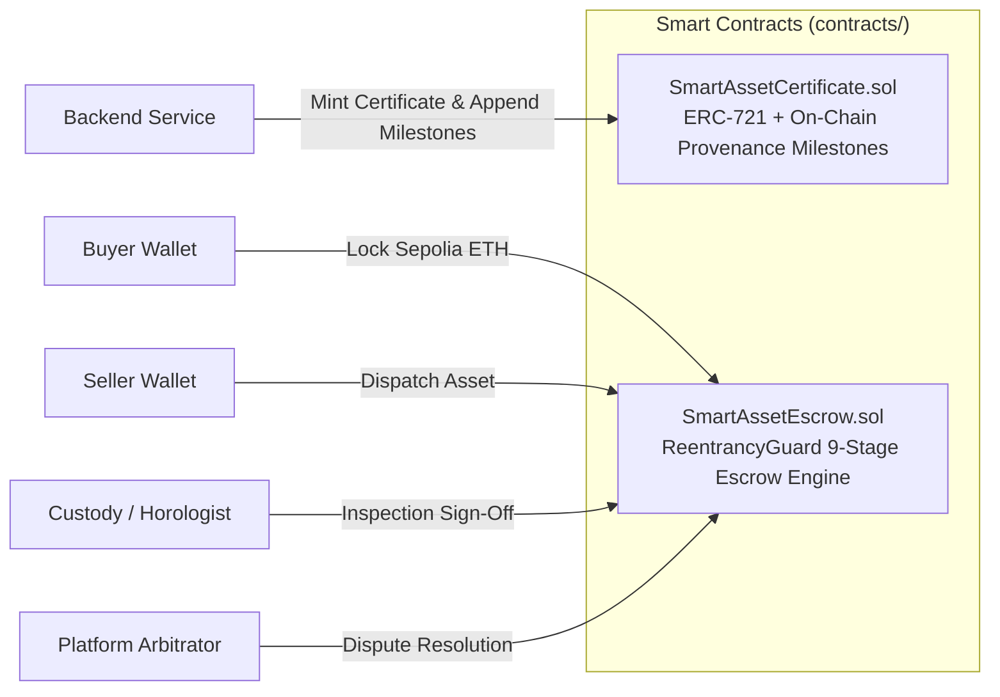

# SmartAssets — Blockchain & Smart Contracts

> **Network:** Ethereum Sepolia Testnet (Chain ID: `11155111`)  
> **Development Framework:** Hardhat 2.22.x  
> **Solidity Compiler:** `^0.8.24`  
> **OpenZeppelin Contracts:** `ERC721URIStorage`, `Ownable`, `ReentrancyGuard`

---

## 📜 Contract Suite Overview

The Blockchain module provides trust-minimized asset tokenization, chain-of-custody tracking, and funds custody:



### 1. `SmartAssetCertificate.sol`
- Standard **ERC-721** non-fungible token implementing OpenZeppelin's `ERC721URIStorage` and `Ownable`.
- Maintains on-chain structs for certificate metadata: `certNumber`, `assetCategory`, `assetValue`, and `mintedAt`.
- Implements dynamic on-chain array `_milestones` storing timestamps, inspector identity, SHA-256 event hashes, and descriptions for every appraisal or ownership transition.

### 2. `SmartAssetEscrow.sol`
- Industrial-grade luxury escrow contract designed to hold buyer funds in trust until physical inspection and delivery are accepted.
- Enforces strict sequential order transitions across 9 states:
  `None` -> `PaymentLocked` -> `InTransit` -> `InInspection` -> `Delivered` -> `Accepted` -> `ReleasedToSeller` (or `Disputed` -> `RefundedToBuyer` / `ReleasedToSeller`).
- Protected against recursive execution vulnerabilities via OpenZeppelin's `ReentrancyGuard`.

---

## 🛠️ Development & Deployment

### 1. Install Dependencies
```bash
cd d:\Native\SmartAssets\Blockchain
npm install
```

### 2. Compile Contracts
```bash
npx hardhat compile
```
Artifacts and ABIs will be written to `Blockchain/artifacts/contracts/`.

### 3. Run Unit Tests
```bash
npx hardhat test
```

### 4. Local Development Node
```bash
npx hardhat node
```

### 5. Deploy to Sepolia Testnet
Ensure your `.env` contains `SEPOLIA_RPC_URL` and `PRIVATE_KEY`:
```bash
npx hardhat run scripts/deploy.js --network sepolia
```

---

## 📚 Related Documentation
- [Smart Contracts & Blockchain Specification](../docs/BLOCKCHAIN_SMART_CONTRACTS.md)
- [System Architecture Guide](../docs/ARCHITECTURE.md)
- [Visual Diagrams & State Machines](../docs/SYSTEM_DIAGRAMS.md)
