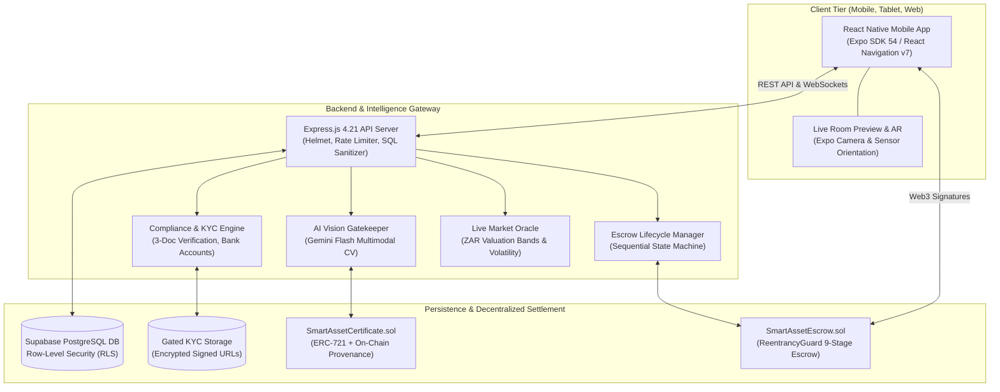

# SmartAssets — Luxury Collectible Tokenization & Custody Platform

[](https://expo.dev/)
[](https://nodejs.org/)
[](https://supabase.com/)
[](https://sepolia.etherscan.io/)
[](https://ai.google.dev/)
[](LICENSE)

> **SmartAssets** is an institutional-grade, decentralized platform designed for physical luxury collectible tokenization, verifiable Horological/Gemological custody, multi-tier AI counterfeit detection, and fractional co-ownership.

---

## 🏛️ High-Level System Architecture

SmartAssets combines a high-performance **React Native (Expo)** mobile application, an **Express.js + Supabase** API and compliance gateway, a **Google Gemini Flash** multimodal computer vision gatekeeper, and **Ethereum Sepolia** smart contracts for on-chain provenance and escrow settlement.



---

## 📂 Repository Directory Layout

```
SmartAssets/
├── docs/                      # Centralized Master Documentation Hub
│   ├── README.md              # Documentation index and role-based reading guides
│   ├── SYSTEM_DIAGRAMS.md     # Production Mermaid diagrams for all subsystems
│   ├── ARCHITECTURE.md        # Comprehensive multi-tier architecture specification
│   ├── FRONTEND_ARCHITECTURE.md # React Native Expo engineering & component guide
│   ├── BACKEND_API.md         # Express REST API endpoints & KYC workflows
│   ├── BLOCKCHAIN_SMART_CONTRACTS.md # Solidity contracts, ERC-721 & Escrow rules
│   └── DATABASE_SCHEMA.md     # PostgreSQL tables, RLS policies, and migrations
├── Public/App/                # Mobile Frontend (React Native, Expo SDK 54)
│   ├── src/screens/           # 25 production screens (Auth, Market, Escrow, AR, Profile)
│   ├── src/components/        # Theme primitives & LiveRoomPreview camera module
│   ├── src/constants/         # Obsidian & Royal Light theme tokens, vector icon sets
│   └── App.js                 # Application bootstrap & provider wrapping
├── Backend/                   # Backend Server (Node.js, Express, Supabase)
│   ├── src/services/          # AI Vision Gatekeeper, Compliance, Escrow, Tripo 3D
│   ├── src/routes/            # Auth, Asset, Escrow, Bank, Verification routes
│   ├── src/middlewares/       # Auth (JWT), KYC enforcer, Rate Limiter, SQL guard
│   └── supabase_setup.sql     # Master database setup & RLS definitions
├── Blockchain/                # Decentralized Settlement (Hardhat, Solidity ^0.8.24)
│   ├── contracts/             # SmartAssetCertificate.sol & SmartAssetEscrow.sol
│   ├── scripts/               # Automated testnet deployment & verification scripts
│   └── test/                  # Unit and integration test suites
└── Assets/                    # Brand assets, typography, and raw prototypes
```

---

## 🚀 Quick Start Guide

### Prerequisites
- **Node.js:** `v18.x` or `v20.x` LTS
- **Package Manager:** `npm` (v9+)
- **Mobile Environment:** Expo Go app installed on your iOS/Android physical device (recommended for Live Room Preview)

---

### 1. Backend API Server Setup
```bash
# Navigate to Backend
cd d:\Native\SmartAssets\Backend

# Install dependencies
npm install

# Start Express server in development mode (watch mode)
npm run dev

# Server launches at http://localhost:5000
# Admin Console available at http://localhost:5000/admin
```

---

### 2. Mobile App Setup (React Native Expo)
```bash
# Navigate to Mobile workspace
cd d:\Native\SmartAssets\Public\App

# Install dependencies
npm install

# Start Expo dev server
npm start

# Controls:
# - Press 'a' to open Android emulator
# - Press 'i' to open iOS simulator
# - Press 'w' to launch Web interface
# - Scan the terminal QR code with Expo Go on a physical phone
```

---

### 3. Blockchain Smart Contracts Setup (Hardhat)
```bash
# Navigate to Blockchain workspace
cd d:\Native\SmartAssets\Blockchain

# Install dependencies
npm install

# Compile Solidity contracts
npx hardhat compile

# Run automated smart contract test suite
npx hardhat test

# Launch a local Hardhat node
npx hardhat node
```

---

## 🔒 Security & Key Guarantees

1. **3-Document Institutional KYC:** Sellers and high-value transactors must provide Government ID, Tax Certificate, and Proof of Residence before listing or withdrawing funds.
2. **AI Vision Anti-Counterfeit Guard:** Google Gemini Vision performs pixel-level inspection, hallmark identification, and synthetic deepfake detection.
3. **Dual-Ledger Escrow:** Funds are protected under `SmartAssetEscrow.sol` with ReentrancyGuard, physical Horological inspection, and explicit delivery sign-off.
4. **Row-Level Security (RLS):** Supabase PostgreSQL isolates sensitive user portfolios, KYC documents, and bank details at the database kernel level.

---

## 📚 Complete Documentation

For comprehensive engineering deep-dives and diagrams, explore the [`docs/`](file:///d:/Native/SmartAssets/docs/README.md) directory:
- [System Architecture](file:///d:/Native/SmartAssets/docs/ARCHITECTURE.md)
- [Visual Diagrams & State Machines](file:///d:/Native/SmartAssets/docs/SYSTEM_DIAGRAMS.md)
- [Mobile Frontend Guide](file:///d:/Native/SmartAssets/docs/FRONTEND_ARCHITECTURE.md)
- [Backend REST API Reference](file:///d:/Native/SmartAssets/docs/BACKEND_API.md)
- [Blockchain Smart Contracts](file:///d:/Native/SmartAssets/docs/BLOCKCHAIN_SMART_CONTRACTS.md)
- [Database Schema & RLS Policies](file:///d:/Native/SmartAssets/docs/DATABASE_SCHEMA.md)
