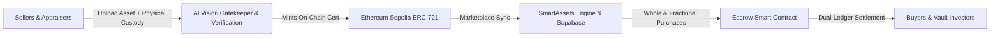
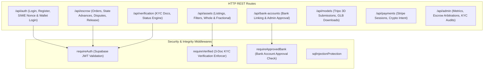
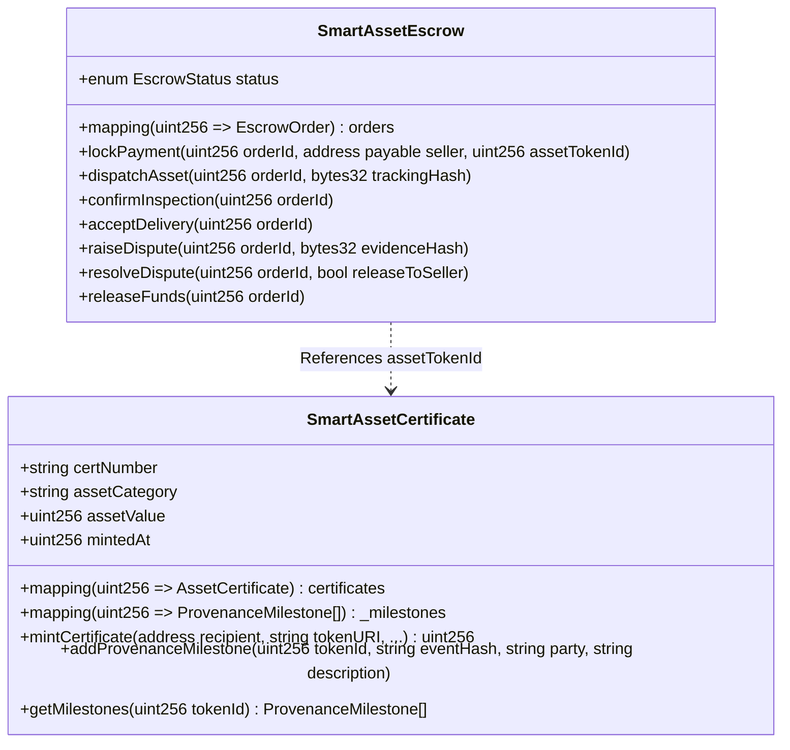

# SmartAssets — Full System Architecture Guide

> **Status:** Production Architecture Specification  
> **Last Updated:** October 2026  
> **Ecosystem:** Mobile (Expo SDK 54 / React Native), Backend (Node.js / Express 4.21 / WebSockets), Database (Supabase PostgreSQL + RLS), Blockchain (Ethereum Sepolia / ERC-721 / Escrow), Intelligence (Google Gemini Vision API + Market Oracle).

---

## 1. Executive Overview

**SmartAssets** is an institutional-grade, multi-tier platform for luxury collectible tokenization, verifiable physical custody, and fractional co-ownership. It solves three chronic failure modes of high-value marketplace commerce:
1. **The Counterfeit Problem:** Counterfeits are combated through a multi-tier **AI Vision Gatekeeper** powered by Google Gemini Vision API and an on-chain **ERC-721 Certificate of Authenticity** with immutable chain-of-custody provenance milestones.
2. **The Settlement & Counterparty Risk Problem:** Solved via **`SmartAssetEscrow.sol`** and a durable dual-ledger escrow lifecycle that locks funds until physical verification by certified horologists/gemologists and buyer delivery acceptance.
3. **The Capital Barrier Problem:** High-value rare collectibles (Patek Philippe, vintage Ferraris, blue-chip art) are fractionalized into verified co-ownership shares with automated valuation feeds from the **Live Market Oracle**.



---

## 2. Technology Stack Matrix

| Tier | Component | Technology / Library | Role & Rationale |
| :--- | :--- | :--- | :--- |
| **Client / Mobile** | Mobile App | **React Native (Expo SDK 54)** | Cross-platform (iOS, Android, Web) with 60 FPS native performance. |
| | Navigation | **React Navigation v7** | Two-tier architecture: Root Native Stack + Floating Glass Bottom Tab Bar. |
| | Icons & Graphics | **`@expo/vector-icons` + `expo-linear-gradient`** | Crisp SVG vector glyphs (`Ionicons`, `Feather`) dynamic with theme tokens. |
| | Camera & AR | **`expo-camera` + `expo-sensors`** | Live Room Preview: Calibrated A4 real-world scale 2D/3D artwork placement. |
| | 3D Rendering | **Three.js / Expo GL** | Interactive 3D inspection of optimized GLB models generated via Tripo AI. |
| **Backend / API** | API Gateway | **Express.js v4.21** | RESTful routing, body limits (15MB upload, 1MB strict API), CORS. |
| | Security | **Helmet v8 + Custom Security Headers** | XSS protection, anti-clickjacking, no-sniff, strict SQL injection filters. |
| | Rate Limiting | **`express-rate-limit`** | 30 req/15min on production auth routes, brute force prevention. |
| | WebSockets | **`ws` v8.21** | Real-time presence indicators, live price ticks, and push notifications. |
| **Intelligence** | Computer Vision | **Google Gemini Flash Vision API** | Multimodal image inspection, hallmark validation, synthetic fake detection. |
| | 3D AI Generator | **Tripo AI Engine** | Image-to-3D mesh generation pipeline. |
| | Mesh Optimizer | **`@gltf-transform/core` + `meshoptimizer`** | Mesh decimation (500k -> 35k tris), texture downscaling, vertex quantization. |
| | Live Oracle | **Custom Market Oracle Service** | Real-time ZAR pricing bands, floor calculations, and historical volatility. |
| **Persistence** | Database | **Supabase PostgreSQL 15** | Relational source of truth with strict **Row-Level Security (RLS)** policies. |
| | Authentication | **Supabase Auth + SIWE (EIP-4361)** | Hybrid email/password and cryptographic Web3 wallet signature login. |
| | Media & Storage | **Private Storage + Cloudinary CDN** | Gated KYC bucket (signed URLs) and Cloudinary for public image assets. |
| **Decentralized** | Blockchain Network | **Ethereum Sepolia Testnet** | EVM-compatible consensus with sub-minute transaction finality. |
| | Certificate Token | **`SmartAssetCertificate.sol`** | ERC-721 URI storage with on-chain `_milestones` provenance history. |
| | Escrow Contract | **`SmartAssetEscrow.sol`** | Reentrancy-guarded 9-state escrow trust engine with dispute arbitrator. |
| | Development Suite | **Hardhat v2.22 + Ethers.js v6** | Local node simulation, compilation, unit test suites, deploy scripts. |

---

## 3. Subsystem Architecture

### 3.1 Mobile Client Architecture (`Public/App`)

The mobile client is organized around modular separation of concerns:
```
Public/App/
├── App.js                     # Root bootstrap with ThemeProvider, AuthProvider, GestureHandler
├── src/
│   ├── components/            # Atomic design components (Button, Badge, Card, Modal)
│   │   ├── liveRoomPreview/   # CameraView, A4 calibration, gesture pan/pinch/rotate overlay
│   │   └── ui.js              # Theme-aware foundational primitives
│   ├── constants/             # Design tokens: theme.js (Obsidian Dark & Cream Light), navigation.js
│   ├── context/               # AuthContext.js (session management) & ThemeContext.js
│   ├── navigation/            # AppNavigator.js (Stack & custom floating glass tab bar)
│   ├── screens/               # 25 screens covering Auth, Market, Escrow, AR, Profile, Analytics
│   └── services/              # API clients: authApi, assetApi, escrowApi, scanKnowApi
```

#### Key Client Subsystems:
1. **Dynamic Theme Engine (`src/constants/theme.js`):**
   - Supports seamless runtime switching between **Obsidian Dark** (`#0B0F19`) and **Royal Light** (`#F3EEFF`).
   - Standardized semantic tokens: `c.primary` (`#C9A84C` / `#1D4ED8`), `c.accent` (`#00C2FF`), `c.green` (`#10B981`), `c.border`, `c.card`.
2. **Vector Iconography:**
   - 100% standardized on `@expo/vector-icons` (`Ionicons` and `Feather`). Emojis and unicode characters are strictly forbidden in UI primitives.
3. **Live Room Preview & AR (`LiveRoomPreview.js`):**
   - Combines uninterrupted camera feed with real-time physical scale calibration (A4 reference card sheet) and gyroscope/accelerometer motion offset.

---

### 3.2 Backend API & Domain Services (`Backend/src`)

The Express backend acts as the secure orchestrator between client apps, AI models, third-party gateways, Supabase, and the Ethereum blockchain:



#### Core Service Modules:
- **`aiVisionGatekeeper.js`:** 4-tier multimodal analysis inspecting image pixels, rejecting synthetic deepfakes, verifying category integrity, and interfacing with the live market oracle.
- **`complianceService.js`:** Enforces strict 3-document compliance (`id`, `tax`, `proof_of_residence`), manages private storage buckets, and provides short-lived signed URLs for admin auditor access.
- **`escrowService.js`:** Durable state machine managing buyer funds, carrier tracking, physical horological inspection, buyer acceptance, and dispute arbitration.
- **`investmentPositionService.js`:** Coordinates fractional share allocations, prevents phantom balances, and maintains user investment portfolios in `public.investment_positions`.
- **`marketOracleService.js`:** Real-time pricing models incorporating volatility indicators, market floor calculations, and ZAR currency conversions.
- **`modelOptimizer.js`:** Node.js worker leveraging `@gltf-transform/core` and `meshoptimizer` to downsample complex 3D meshes for low-end mobile devices.

---

### 3.3 Blockchain & Decentralized Settlement (`Blockchain/`)

The blockchain tier operates on the **Ethereum Sepolia Testnet** and ensures that collectible authenticity and funds custody are trust-minimized.



1. **`SmartAssetCertificate.sol` (ERC-721):**
   - Mints unique non-fungible tokens representing luxury assets.
   - Embeds verifiable chain-of-custody milestones directly on-chain (`addProvenanceMilestone`), recording inspection timestamps, verifier signatures, and cryptographic event hashes.
2. **`SmartAssetEscrow.sol`:**
   - Implements OpenZeppelin's `ReentrancyGuard` to prevent reentrancy attacks during ETH settlement.
   - Enforces sequential role-based method execution (e.g. only seller can dispatch, only buyer or inspector can accept/confirm delivery, only designated arbitrator can resolve disputes).

---

## 4. Cross-Cutting Concerns

### 4.1 Security & Compliance
- **Zero-Trust KYC Document Handling:** Documents submitted by users are stored in the private `verification-docs` Supabase bucket. File signatures are verified using magic byte sniffing (`detectBufferSignature`) rather than trusting file extensions. Direct access is denied; only authenticated owners and administrators can retrieve short-lived (60-minute) signed URLs.
- **Strict Role-Based Access Control (RBAC):** Privileged actions such as listing assets or requesting withdrawals require passed KYC (`requireVerified`) and an approved bank account (`requireApprovedBank`).
- **SQL Injection Defense:** All incoming query strings, route parameters, and JSON payloads (excluding raw image buffers) pass through a multi-pattern regex sanitizer (`sqlInjectionProtection`).

### 4.2 High-Reliability Dual-Ledger Architecture
To guarantee that network drops or blockchain node latency never cause lost funds or orphaned records:
1. Every escrow action is first staged in Supabase with transaction status `pending`.
2. The transaction is submitted to Ethereum Sepolia via `web3Service.js`.
3. Upon receiving transaction receipt and confirmation blocks, the Supabase record is updated with `tx_hash` and status `confirmed`.
4. If the blockchain transaction fails or reverts, the backend executes an automatic compensatory rollback.

---

## 5. Architectural References & Diagram Index

- For complete visual diagrams of all workflows, see [SYSTEM_DIAGRAMS.md](file:///d:/Native/SmartAssets/docs/SYSTEM_DIAGRAMS.md).
- For mobile screen navigation and component design details, see [FRONTEND_ARCHITECTURE.md](file:///d:/Native/SmartAssets/docs/FRONTEND_ARCHITECTURE.md).
- For complete Express REST API documentation, see [BACKEND_API.md](file:///d:/Native/SmartAssets/docs/BACKEND_API.md).
- For Solidity smart contract specifications and test procedures, see [BLOCKCHAIN_SMART_CONTRACTS.md](file:///d:/Native/SmartAssets/docs/BLOCKCHAIN_SMART_CONTRACTS.md).
- For database schemas and Supabase RLS policies, see [DATABASE_SCHEMA.md](file:///d:/Native/SmartAssets/docs/DATABASE_SCHEMA.md).
