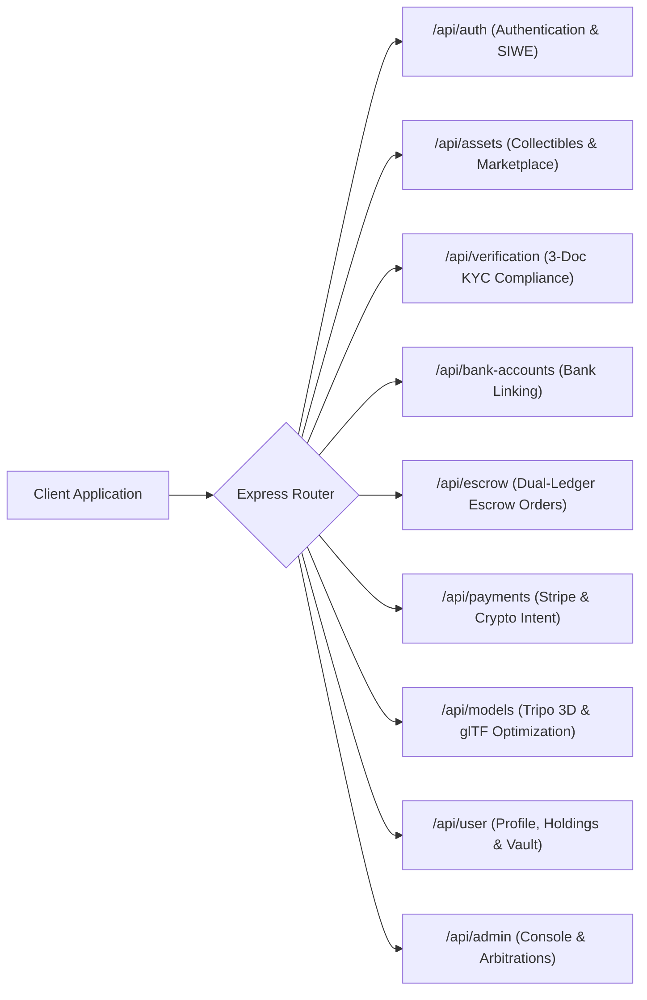
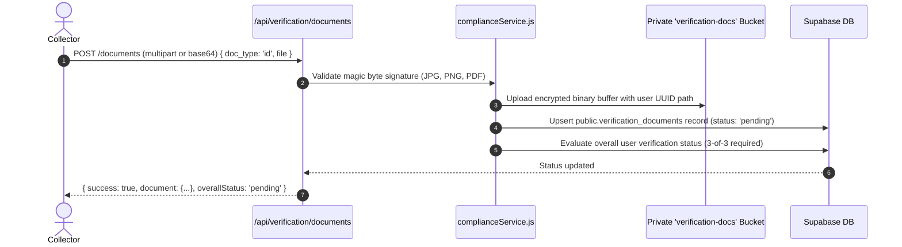

# SmartAssets — Backend API Specification & Developer Reference

> **Server:** Express.js 4.21.2 on Node.js (CommonJS)  
> **Default Port:** `5000` (e.g. `http://localhost:5000`)  
> **Database:** Supabase PostgreSQL with Row-Level Security (RLS)  
> **Blockchain Integration:** Ethers.js v6 (Ethereum Sepolia Testnet)  
> **Location:** `Backend/src/`

---

## 1. Global Security, Headers & Request Limits

### 1.1 Base Headers & Security Enforcement
Every response includes security headers managed by `helmet` and custom middleware:
- `X-Content-Type-Options: nosniff`
- `X-Frame-Options: SAMEORIGIN`
- `X-XSS-Protection: 1; mode=block`
- `Referrer-Policy: strict-origin-when-cross-origin`

### 1.2 Rate Limiting
- **Authentication Routes (`/api/auth/*`):** Limited to **30 requests per 15-minute window** in production (300 in development). Standard headers `RateLimit-Limit`, `RateLimit-Remaining`, and `RateLimit-Reset` are attached.

### 1.3 Payload Body Limits
- **Standard Endpoints:** Strict **1MB** JSON / URL-encoded body limit.
- **Upload Endpoints (`/api/uploads`, `/api/verification`, `/api/assets`, `/api/list-item`):** Extended **15MB** limit to accommodate high-resolution collectible photography, documents, and 3D glTF buffers.

### 1.4 Authentication Mechanism
Protected routes require a Bearer token header:
```http
Authorization: Bearer <supabase_jwt_access_token>
```

---

## 2. API Endpoints Directory



---

## 3. Detailed Endpoint Reference

### 3.1 Authentication (`/api/auth`)

#### `POST /api/auth/register`
Creates a new user in Supabase Auth and triggers automatic creation of a row in `public.profiles`.
- **Request Body:**
  ```json
  {
    "email": "collector@example.com",
    "password": "SecurePassword123!",
    "full_name": "Alexander Wright"
  }
  ```
- **Response (200 OK):**
  ```json
  {
    "success": true,
    "user": { "id": "b3e34b22-...", "email": "collector@example.com" },
    "token": "eyJhbGciOiJIUzI1NiIs..."
  }
  ```

#### `POST /api/auth/login`
Authenticates existing users with email and password.
- **Request Body:** `{ "email": "...", "password": "..." }`
- **Response (200 OK):** `{ "success": true, "token": "...", "user": {...}, "profile": {...} }`

#### `GET /api/auth/nonce?address=0x...`
Generates a cryptographically secure 5-minute single-use nonce for Sign-In With Ethereum (SIWE / EIP-4361).
- **Response (200 OK):**
  ```json
  {
    "success": true,
    "nonce": "smartassets_nonce_8f19da3c9b7...",
    "issuedAt": "2026-10-27T22:00:00.000Z"
  }
  ```

#### `POST /api/auth/wallet-login`
Verifies an ECDSA signature over an EIP-4361 message, recovering the signer address and returning an authenticated session.
- **Request Body:**
  ```json
  {
    "address": "0x71C...9a",
    "signature": "0x3a4b...",
    "message": "smartassets.app wants you to sign in with your Ethereum account..."
  }
  ```
- **Response (200 OK):** `{ "success": true, "token": "...", "user": {...}, "profile": {...} }`

---

### 3.2 Compliance & KYC Verification (`/api/verification`)

SmartAssets enforces an institutional 3-document compliance engine:
1. `id` (Government Passport, ID Card, or Driver's License)
2. `tax` (Tax Number Notice / SARS Assessment)
3. `proof_of_residence` (Utility Bill / Bank Statement under 3 months old)



#### `POST /api/verification/documents`
Uploads a compliance document. Requires `Authorization: Bearer <token>`.
- **Request Body (JSON or Form-Data):**
  ```json
  {
    "doc_type": "id",
    "file": "data:image/jpeg;base64,...",
    "original_name": "passport_scan.jpg"
  }
  ```
- **Response (200 OK):**
  ```json
  {
    "success": true,
    "document": {
      "id": "9b1deb4d-...",
      "doc_type": "id",
      "status": "pending",
      "original_name": "passport_scan.jpg",
      "created_at": "2026-10-27T22:00:00Z"
    },
    "verification_status": "pending"
  }
  ```

#### `GET /api/verification/status`
Returns the status of all uploaded documents and the aggregate user verification level (`unverified` | `pending` | `verified` | `rejected`).

---

### 3.3 Bank Account Verification (`/api/bank-accounts`)

To prevent illicit withdrawals and money laundering, payouts are restricted to administrator-verified bank accounts.

#### `POST /api/bank-accounts`
Submits a bank account for validation.
- **Request Body:**
  ```json
  {
    "bank_name": "Standard Bank",
    "account_number": "1019283746",
    "account_holder_name": "Alexander Wright",
    "branch_code": "051001",
    "account_type": "cheque"
  }
  ```
- **Response (200 OK):** Returns masked account (`****3746`) with initial status `pending`.

---

### 3.4 Assets & Marketplace (`/api/assets` & `/api/list-item`)

#### `GET /api/assets`
Fetches active marketplace listings with optional category, search, and pricing filters.
- **Query Params:** `category`, `search`, `minPrice`, `maxPrice`, `sort`
- **Response (200 OK):** Array of asset records including on-chain token ID and fractional share parameters.

#### `POST /api/list-item` (or `POST /api/assets`)
Requires `requireAuth` and `requireVerified`. Triggers the **AI Vision Gatekeeper** pipeline:
- **Request Body:**
  ```json
  {
    "name": "Rolex Daytona 116500LN",
    "category": "Luxury Watch",
    "price": "R 485,000",
    "price_num": 485000,
    "year": 2022,
    "condition": "Mint",
    "image": "https://res.cloudinary.com/.../daytona.jpg",
    "description": "Cerachrom bezel, full box and papers, verified horological serial.",
    "shares": 100,
    "share_price": 4850
  }
  ```
- **Response (201 Created):**
  ```json
  {
    "success": true,
    "asset": {
      "id": "e4f2081d-...",
      "token_id": "184",
      "tx_hash": "0x89ab...71",
      "badge": "Verified",
      "status": "active"
    }
  }
  ```

---

### 3.5 Escrow Management (`/api/escrow`)

Coordinates the 9-stage escrow trust engine between buyer, seller, appraiser, and arbitrator:

| Method & Route | Authorization | Description |
| :--- | :--- | :--- |
| `POST /api/escrow/orders` | Buyer | Creates order and locks funds (`PaymentLocked`). |
| `POST /api/escrow/:id/dispatch` | Seller | Submits carrier & tracking number (`InTransit`). |
| `POST /api/escrow/:id/inspect` | Appraiser | Confirms physical inspection and authenticity (`InInspection`). |
| `POST /api/escrow/:id/accept` | Buyer | Acknowledges receipt and signs off condition (`Accepted`). |
| `POST /api/escrow/:id/release` | Buyer/Admin | Releases funds to seller (`ReleasedToSeller`). |
| `POST /api/escrow/:id/dispute` | Buyer/Seller | Submits dispute claims and evidence (`Disputed`). |
| `POST /api/escrow/:id/resolve` | Admin | Resolves dispute with refund or release. |

---

### 3.6 3D Model Optimization (`/api/models`)

Interacts with Tripo AI and the backend mesh decimation engine:
- `POST /api/models/generate`: Submits single photo to Tripo image-to-3D pipeline.
- `GET /api/models/task/:taskId`: Polls task status (`pending`, `running`, `success`).
- `POST /api/models/optimize`: Runs `@gltf-transform` to decimate mesh to under 35k polygons for smooth 60 FPS mobile rendering.
