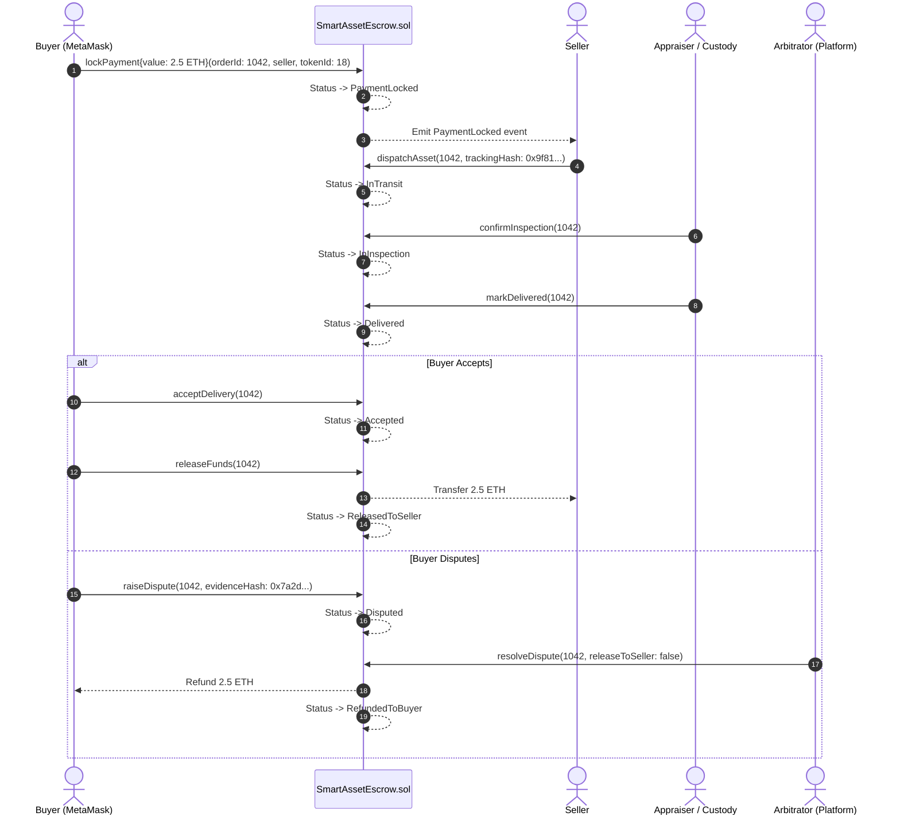

# SmartAssets — Blockchain & Smart Contracts Specification

> **EVM Network:** Ethereum Sepolia Testnet (Chain ID: `11155111`)  
> **Framework:** Hardhat 2.22.x  
> **Solidity Compiler:** `^0.8.24`  
> **Core Libraries:** OpenZeppelin Contracts (`ERC721URIStorage`, `Ownable`, `ReentrancyGuard`)  
> **Location:** `Blockchain/`

---

## 1. Smart Contract Architecture

The decentralized layer guarantees trust-minimized authenticity and payment security via two cooperating contracts:

```mermaid
flowchart TD
    subgraph CONTRACTS ["Smart Contracts (Blockchain/contracts)"]
        CERT["SmartAssetCertificate.sol<br/>ERC-721 Luxury Token & On-Chain Provenance"]
        ESCROW["SmartAssetEscrow.sol<br/>ReentrancyGuard 9-Stage Escrow Vault"]
    end

    subgraph OFF_CHAIN ["Off-Chain System"]
        API["Backend Web3 Service (Ethers.js v6)"]
        METAMASK["Buyer & Seller MetaMask Wallets"]
    end

    API -->|1. mintCertificate()| CERT
    API -->|2. addProvenanceMilestone()| CERT
    METAMASK -->|3. lockPayment() (Sepolia ETH)| ESCROW
    API -->|4. dispatchAsset() / confirmInspection()| ESCROW
    METAMASK -->|5. acceptDelivery() / releaseFunds()| ESCROW
```

---

## 2. `SmartAssetCertificate.sol` (ERC-721 Certificate of Authenticity)

An extended **ERC-721** non-fungible token that stores asset identification, appraised valuation, and a tamper-proof on-chain array of chain-of-custody milestones.

### 2.1 State Variables & Structs

```solidity
struct AssetCertificate {
    string certNumber;       // Unique certificate identifier (e.g. "SMARTCERT-2026-9812")
    string assetCategory;     // e.g. "Luxury Watch", "Fine Art", "Classic Car"
    uint256 assetValue;       // Appraisal value in wei or fiat-pegged integer
    uint256 mintedAt;         // Unix timestamp of minting
}

struct ProvenanceMilestone {
    uint256 timestamp;        // Milestone timestamp
    string eventHash;         // Cryptographic SHA-256 hash of inspection report / evidence
    string description;       // e.g. "Certified Horologist Movement Overhaul & Appraisal"
    string party;             // Authorized inspector or custody facility name
}

mapping(uint256 => AssetCertificate) public certificates;
mapping(uint256 => ProvenanceMilestone[]) private _milestones;
```

### 2.2 Core Functions
- **`mintCertificate(address recipient, string tokenURI, string certNumber, string category, uint256 value) returns (uint256)`:**
  Mints a new Certificate of Authenticity NFT to the recipient's address, assigns metadata URI, stores certificate parameters, and emits `CertificateMinted`.
- **`addProvenanceMilestone(uint256 tokenId, string eventHash, string party, string description)`:**
  Appends an immutable provenance milestone entry to the token's on-chain ledger and emits `ProvenanceRecorded`. Only the contract owner / authorized appraiser can invoke.
- **`getMilestones(uint256 tokenId) external view returns (ProvenanceMilestone[] memory)`:**
  Returns the complete array of recorded chain-of-custody milestones for transparent public verification on Etherscan or in the mobile app.

---

## 3. `SmartAssetEscrow.sol` (Sequential Escrow Trust Engine)

Secures buyer funds in an Ethereum smart contract and releases them only after verified transit, physical Horological/Gemological authentication, and explicit delivery acceptance.

### 3.1 Escrow Lifecycle States (`enum EscrowStatus`)

```solidity
enum EscrowStatus {
    None,              // 0: Order uninitialized
    PaymentLocked,     // 1: Buyer has deposited ETH/tokens into the contract
    InTransit,         // 2: Seller dispatched asset with tracked courier
    InInspection,      // 3: Received at custody facility; appraiser inspecting
    Delivered,         // 4: Physical asset reached buyer
    Accepted,          // 5: Buyer signed off condition and accepted delivery
    Disputed,          // 6: Either party initiated a formal dispute
    ReleasedToSeller,  // 7: Settlement complete; funds paid to seller
    RefundedToBuyer    // 8: Dispute resolved or canceled; funds returned to buyer
}
```

### 3.2 State Transition Matrix & Access Control

| Action / Function | Current Status Required | Permitted Caller | Next Status |
| :--- | :--- | :--- | :--- |
| `lockPayment(orderId, seller, assetTokenId)` | `None` | Buyer (`msg.value > 0`) | `PaymentLocked` |
| `dispatchAsset(orderId, trackingHash)` | `PaymentLocked` | Seller | `InTransit` |
| `confirmInspection(orderId)` | `InTransit` | Custody Officer / Owner | `InInspection` |
| `markDelivered(orderId)` | `InInspection` | Custody / Armored Courier | `Delivered` |
| `acceptDelivery(orderId)` | `Delivered` | Buyer | `Accepted` |
| `releaseFunds(orderId)` | `Accepted` | Buyer or Arbitrator | `ReleasedToSeller` |
| `raiseDispute(orderId, evidenceHash)` | `PaymentLocked`, `InTransit`, `InInspection`, `Delivered` | Buyer or Seller | `Disputed` |
| `resolveDispute(orderId, releaseToSeller)`| `Disputed` | Designated Arbitrator / Owner | `ReleasedToSeller` or `RefundedToBuyer` |

---

## 4. End-to-End Escrow Interaction Diagram



---

## 5. Security & Reentrancy Defenses

1. **`ReentrancyGuard`:** All state-changing payment transfer functions utilize OpenZeppelin's `nonReentrant` modifier to neutralize recursive call vulnerabilities.
2. **Checks-Effects-Interactions Pattern:** Internal state variables (`order.status = EscrowStatus.ReleasedToSeller`) are updated before executing external ether transfers (`seller.call{value: amount}("")`).
3. **Integer Overflow Protection:** Native Solidity `^0.8.24` includes checked arithmetic preventing uint overflow/underflow exploits.

---

## 6. Compilation, Testing & Deployment Commands

```bash
# Navigate to Blockchain workspace
cd d:\Native\SmartAssets\Blockchain

# Install dependencies
npm install

# Compile contracts
npx hardhat compile

# Run Hardhat unit tests
npx hardhat test

# Run a local Ethereum test node
npx hardhat node

# Deploy contracts to Sepolia testnet
npx hardhat run scripts/deploy.js --network sepolia
```
