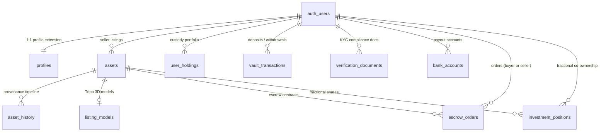

# SmartAssets — Database Schema & Supabase Architecture

> **Database:** PostgreSQL 15 (Supabase Managed Engine)  
> **Security:** Strict Row-Level Security (RLS) Enabled on all public tables  
> **Migrations Directory:** `Backend/supabase_migrations/`  
> **Master SQL Setup:** `Backend/supabase_setup.sql`

---

## 1. Relational Schema Architecture

The database serves as the high-throughput, ACID-compliant relational foundation of SmartAssets, syncing user identity, assets, fractional ownership, KYC compliance, and dual-ledger escrow.



---

## 2. Table Specifications

### 2.1 `public.profiles`
Extends `auth.users` with application-specific metadata, wallet addresses, and available fiat balance.
```sql
CREATE TABLE public.profiles (
  id              UUID PRIMARY KEY REFERENCES auth.users(id) ON DELETE CASCADE,
  full_name       TEXT NOT NULL,
  email           TEXT NOT NULL,
  wallet_address  TEXT UNIQUE,
  avatar_url      TEXT,
  balance         NUMERIC DEFAULT 0,
  created_at      TIMESTAMPTZ DEFAULT NOW()
);
```

### 2.2 `public.assets`
Stores high-value luxury collectibles listed for sale, auction, or fractional co-ownership.
```sql
CREATE TABLE public.assets (
  id               UUID PRIMARY KEY DEFAULT gen_random_uuid(),
  user_id          UUID REFERENCES auth.users(id) ON DELETE SET NULL,
  name             TEXT NOT NULL,
  category         TEXT NOT NULL,
  price            TEXT NOT NULL,
  price_num        NUMERIC NOT NULL DEFAULT 0,
  year             INTEGER NOT NULL DEFAULT 2024,
  condition        TEXT NOT NULL DEFAULT 'Mint',
  description      TEXT,
  image            TEXT NOT NULL,
  badge            TEXT DEFAULT 'Verified',
  trending         BOOLEAN DEFAULT false,
  cert             TEXT,
  shares           INTEGER DEFAULT 100,
  share_price      NUMERIC DEFAULT 100,
  shares_sold      INTEGER DEFAULT 0,
  status           TEXT DEFAULT 'active',
  token_id         TEXT,
  tx_hash          TEXT,
  contract_address TEXT,
  etherscan_url    TEXT,
  created_at       TIMESTAMPTZ DEFAULT NOW()
);
```

### 2.3 `public.asset_history`
Maintains verified chain-of-custody milestones and ownership transitions for each collectible.
```sql
CREATE TABLE public.asset_history (
  id         UUID PRIMARY KEY DEFAULT gen_random_uuid(),
  asset_id   UUID NOT NULL REFERENCES public.assets(id) ON DELETE CASCADE,
  year       TEXT NOT NULL,
  event      TEXT NOT NULL,
  party      TEXT NOT NULL,
  hash       TEXT,
  tx_hash    TEXT,
  verified   BOOLEAN DEFAULT true,
  created_at TIMESTAMPTZ DEFAULT NOW()
);
```

### 2.4 `public.user_holdings`
Represents assets held in a collector's personal vault, isolated per user.
```sql
CREATE TABLE public.user_holdings (
  id          UUID PRIMARY KEY DEFAULT gen_random_uuid(),
  user_id     UUID NOT NULL REFERENCES auth.users(id) ON DELETE CASCADE,
  name        TEXT NOT NULL,
  category    TEXT NOT NULL,
  price       TEXT NOT NULL,
  price_num   NUMERIC NOT NULL DEFAULT 0,
  gain        TEXT DEFAULT '+0.0%',
  gain_pct    TEXT DEFAULT '0%',
  positive    BOOLEAN DEFAULT true,
  image       TEXT,
  asset_type  TEXT DEFAULT 'whole',  -- 'whole' | 'fractional'
  created_at  TIMESTAMPTZ DEFAULT NOW()
);
```

### 2.5 `public.verification_documents` & `public.bank_accounts`
Supports institutional compliance, Anti-Money Laundering (AML), and bank payouts.
```sql
CREATE TABLE public.verification_documents (
  id               UUID PRIMARY KEY DEFAULT gen_random_uuid(),
  user_id          UUID NOT NULL REFERENCES auth.users(id) ON DELETE CASCADE,
  doc_type         TEXT NOT NULL CHECK (doc_type IN ('id', 'tax', 'proof_of_residence')),
  file_path        TEXT NOT NULL,
  original_name    TEXT,
  mime_type        TEXT,
  file_size        BIGINT,
  status           TEXT NOT NULL DEFAULT 'pending' CHECK (status IN ('pending', 'approved', 'rejected')),
  rejection_reason TEXT,
  created_at       TIMESTAMPTZ DEFAULT NOW()
);

CREATE TABLE public.bank_accounts (
  id                    UUID PRIMARY KEY DEFAULT gen_random_uuid(),
  user_id               UUID NOT NULL REFERENCES auth.users(id) ON DELETE CASCADE,
  account_holder_name   TEXT NOT NULL,
  bank_name             TEXT NOT NULL,
  account_number_masked TEXT NOT NULL,
  branch_code           TEXT,
  account_type          TEXT DEFAULT 'cheque',
  status                TEXT NOT NULL DEFAULT 'pending' CHECK (status IN ('pending', 'approved', 'rejected')),
  created_at            TIMESTAMPTZ DEFAULT NOW()
);
```

### 2.6 `public.escrow_orders` & `public.investment_positions`
Tracks dual-ledger escrow lifecycle and fractional shareholder registers:
```sql
CREATE TABLE public.escrow_orders (
  id                 UUID PRIMARY KEY DEFAULT gen_random_uuid(),
  order_id_seq       SERIAL UNIQUE,
  buyer_id           UUID REFERENCES auth.users(id),
  seller_id          UUID REFERENCES auth.users(id),
  asset_id           UUID REFERENCES public.assets(id),
  amount             NUMERIC NOT NULL,
  currency           TEXT DEFAULT 'ETH',
  status             TEXT NOT NULL DEFAULT 'payment_secured',
  tracking_carrier   TEXT,
  tracking_number    TEXT,
  dispute_reason     TEXT,
  dispute_resolution TEXT,
  tx_hash            TEXT,
  created_at         TIMESTAMPTZ DEFAULT NOW(),
  updated_at         TIMESTAMPTZ DEFAULT NOW()
);

CREATE TABLE public.investment_positions (
  id                       UUID PRIMARY KEY DEFAULT gen_random_uuid(),
  user_id                  UUID NOT NULL REFERENCES auth.users(id) ON DELETE CASCADE,
  asset_id                 UUID NOT NULL REFERENCES public.assets(id) ON DELETE CASCADE,
  shares_owned             INTEGER NOT NULL CHECK (shares_owned > 0),
  purchase_price_per_share NUMERIC NOT NULL,
  total_invested           NUMERIC NOT NULL,
  created_at               TIMESTAMPTZ DEFAULT NOW()
);
```

---

## 3. Row-Level Security (RLS) Policy Matrix

| Table | Operation | Target Role | RLS Policy Logic |
| :--- | :--- | :--- | :--- |
| `profiles` | SELECT | `authenticated` | `auth.uid() = id` (Users only view own profile) |
| `profiles` | UPDATE | `authenticated` | `auth.uid() = id` (Users only edit own profile) |
| `user_holdings` | ALL | `authenticated` | `auth.uid() = user_id` (Strict personal custody isolation) |
| `assets` | SELECT | `anon`, `authenticated` | `true` (Active marketplace listings are public) |
| `assets` | INSERT | `authenticated` | `auth.uid() = user_id` (Verified users create listings) |
| `verification_documents`| SELECT | `authenticated` | `auth.uid() = user_id OR auth.jwt() ->> 'role' = 'admin'` |
| `bank_accounts` | SELECT | `authenticated` | `auth.uid() = user_id OR auth.jwt() ->> 'role' = 'admin'` |
| `escrow_orders` | SELECT | `authenticated` | `auth.uid() = buyer_id OR auth.uid() = seller_id OR auth.jwt() ->> 'role' = 'admin'` |

---

## 4. Storage Buckets

1. **`verification-docs` (Private Bucket):** Gated KYC documents. Direct public downloads are denied; requests require a short-lived (60 min) signed URL issued by `complianceService.js`.
2. **`assets` (Public Bucket):** High-resolution collectible photography, certificates, and inspection images.
3. **`avatars` (Public Bucket):** User profile pictures.
