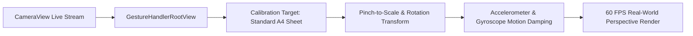

# SmartAssets — Mobile Frontend Architecture & Engineering Guide

> **Framework:** React Native 0.81.5 / Expo SDK 54  
> **Navigation:** React Navigation v7 (Native Stack + Floating Glass Bottom Tab Bar)  
> **Design Language:** Luxury Obsidian & Royal Light with Custom HSL Glassmorphism  
> **Icons:** 100% `@expo/vector-icons` (`Ionicons` + `Feather`)  
> **Location:** `Public/App/`

---

## 1. Directory Structure & Organization

```
Public/App/
├── App.js                     # Root bootstrap: ThemeProvider, AuthProvider, GestureHandlerRootView
├── app.json                   # Expo configuration, plugins (camera, sensors), permissions
├── metro.config.js            # Metro bundler config with SVG and asset resolution
├── package.json               # Expo SDK 54, React Navigation 7, Ethers, Vector Icons
├── src/
│   ├── components/            # Reusable UI primitives & compound widgets
│   │   ├── ui.js              # Buttons, Badges, Cards, Input fields, Stat blocks
│   │   └── liveRoomPreview/   # Camera preview, gesture manipulators, A4 calibration
│   ├── constants/             # Global tokens and route keys
│   │   ├── navigation.js      # SCREENS and TABS route name constants
│   │   ├── theme.js           # Theme palettes (dark / light), colors, spacing, typography
│   │   └── mockData.js        # Fallback catalog and luxury asset presets
│   ├── context/               # Global React state providers
│   │   ├── AuthContext.js     # User session, JWT persistence, login/logout, wallet linking
│   │   └── ThemeContext.js    # isDark state, toggleTheme, AsyncStorage persistence
│   ├── navigation/            # Navigation routing definitions
│   │   └── AppNavigator.js    # Root Native Stack Navigator + Floating Glass Bottom Tabs
│   ├── screens/               # 25 production application screens
│   │   ├── SplashScreen.js            # Luxury obsidian splash with smooth branding
│   │   ├── OnboardingScreen.js        # 3-step value proposition carousel
│   │   ├── LoginScreen.js             # Dual auth: Email/Password + MetaMask Web3
│   │   ├── RegisterScreen.js          # New account registration form
│   │   ├── ResetPasswordScreen.js     # Deep link token recovery flow
│   │   ├── HomeScreen.js              # Marketplace overview, hero carousels, category pills
│   │   ├── SearchScreen.js            # Dynamic discovery, instant query & facet filters
│   │   ├── ListAssetScreen.js         # 4-step seller wizard with AI Vision Gatekeeper
│   │   ├── InvestScreen.js            # Fractional co-ownership marketplace & share purchases
│   │   ├── VaultScreen.js             # User custody portfolio, asset breakdown, deposits/withdrawals
│   │   ├── AssetDetailScreen.js       # Complete asset overview, AI valuation bands, action bar
│   │   ├── CertificateScreen.js       # Digital Certificate of Authenticity with QR code
│   │   ├── ProvenanceScreen.js        # Verified blockchain chain-of-custody timeline
│   │   ├── HealthReportScreen.js      # AI condition grade, authenticity breakdown, fraud score
│   │   ├── CheckoutScreen.js          # Multi-rail checkout (Card, Sepolia ETH, Wire)
│   │   ├── EscrowTrackerScreen.js     # 9-stage escrow progress visualizer with dispute handling
│   │   ├── ScanAndKnowScreen.js       # Camera instant appraisal & vault certificate matching
│   │   ├── ARScreen.js                # 3D interactive model previewer
│   │   ├── VerificationScreen.js      # Seller listing appraisal review tracker
│   │   ├── VerifyAccountScreen.js     # 3-document KYC compliance submission (ID, Tax, Residence)
│   │   ├── BankDetailsScreen.js       # Bank account linking for verified payouts
│   │   ├── ProfileScreen.js           # User account profile, security controls, avatar upload
│   │   └── ProfileAnalyticsScreen.js  # Portfolio analytics, performance charts, asset distribution
│   └── services/              # API clients for Backend communication
```

---

## 2. Navigation Architecture (`src/navigation/AppNavigator.js`)

Navigation utilizes **React Navigation v7** structured into a conditional two-tier state machine governed by `isAuthenticated` and `sessionRestored` from `AuthContext`:

```mermaid
flowchart TD
    ROOT[NavigationContainer (ref: navigationRef)] --> CHECK{sessionRestored?}
    CHECK -->|No| SPINNER[Loading ActivityIndicator]
    CHECK -->|Yes| AUTH_CHECK{isAuthenticated?}

    subgraph UNAUTHENTICATED_FLOW ["Unauthenticated Stack"]
        AUTH_CHECK -->|false| SPLASH[SplashScreen]
        SPLASH --> ONBOARD[OnboardingScreen]
        ONBOARD --> LOGIN[LoginScreen]
        LOGIN -.-> REGISTER[RegisterScreen]
        LOGIN -.-> RESET[ResetPasswordScreen (Deep Link)]
    end

    subgraph AUTHENTICATED_FLOW ["Authenticated Stack"]
        AUTH_CHECK -->|true| TABS[MainTabs (Custom Floating Glass Bar)]
        
        subgraph BOTTOM_TABS ["5 Floating Glass Tabs"]
            TAB_HOME["Home (HomeScreen)"]
            TAB_SEARCH["Market (SearchScreen)"]
            TAB_FAB["[+] Center FAB (ListAssetScreen)"]
            TAB_INVEST["Invest (InvestScreen)"]
            TAB_VAULT["Vault (VaultScreen)"]
        end

        TABS --> TAB_HOME
        TABS --> TAB_SEARCH
        TABS --> TAB_FAB
        TABS --> TAB_INVEST
        TABS --> TAB_VAULT

        subgraph DETAIL_SCREENS ["Contextual Stack Screens"]
            ASSET_DETAIL["AssetDetailScreen"]
            CERTIFICATE["CertificateScreen"]
            PROVENANCE["ProvenanceScreen"]
            HEALTH_REPORT["HealthReportScreen"]
            CHECKOUT["CheckoutScreen"]
            ESCROW_TRACKER["EscrowTrackerScreen"]
            SCAN_KNOW["ScanAndKnowScreen"]
            LIVE_ROOM["LiveRoomPreview (AR)"]
            PROFILE["ProfileScreen"]
            ANALYTICS["ProfileAnalyticsScreen"]
            VERIFY_ACC["VerifyAccountScreen (KYC)"]
            BANK_DETAILS["BankDetailsScreen"]
            VERIFY_STATUS["VerificationScreen"]
        end
    end

    TABS --> ASSET_DETAIL
    ASSET_DETAIL --> CERTIFICATE
    ASSET_DETAIL --> PROVENANCE
    ASSET_DETAIL --> HEALTH_REPORT
    ASSET_DETAIL --> CHECKOUT
    ASSET_DETAIL --> LIVE_ROOM
    CHECKOUT --> ESCROW_TRACKER
    TAB_HOME --> SCAN_KNOW
    TAB_HOME --> PROFILE
    PROFILE --> ANALYTICS
    PROFILE --> VERIFY_ACC
    PROFILE --> BANK_DETAILS
```

### Floating Glass Tab Bar Features:
- **Glassmorphism:** Rendered with backdrop blur filter on web, layered alpha tints on native, and a subtle glowing top border highlight.
- **Center Elevated Action Button (FAB):** The center `ListAsset` tab is styled as a 50px circular floating action button with a dynamic gradient (`#38BDF8` to `#1D4ED8`), an elevated drop shadow, and a prominent plus icon (`Ionicons` `add`).
- **Dynamic Active Pill:** Active tabs render an animated horizontal indicator pill and luminous cyan tint (`#00C2FF`).

---

## 3. Design Token System (`src/constants/theme.js`)

All styling uses native `StyleSheet` objects consuming reactive color tokens provided by `useColors(isDark)`. Hardcoded hex codes are strictly discouraged in individual screen files.

### Color Tokens:
| Token Name | Obsidian Dark (`isDark = true`) | Royal Light (`isDark = false`) | Usage |
| :--- | :--- | :--- | :--- |
| `background` | `#0B0F19` | `#F8FAFC` | Primary screen canvas background |
| `card` | `#131C2E` | `#FFFFFF` | Container cards, list items, modal surfaces |
| `cardAlt` | `#1A263D` | `#F1F5F9` | Secondary cards, table headers, chip pills |
| `border` | `#1F2E47` | `#E2E8F0` | Dividers, card borders, input borders |
| `primary` | `#C9A84C` (Gold) / `#38BDF8` (Cyan) | `#1D4ED8` (Royal Blue) | Primary call-to-action buttons, active highlights |
| `accent` | `#00C2FF` (Luminous Cyan) | `#0284C7` (Sky Blue) | Tab indicators, active pill highlights |
| `green` | `#10B981` (Emerald) | `#059669` (Forest) | Verified badges, positive ROI gains, confirmed status |
| `text` | `#F8FAFC` (Near White) | `#0F172A` (Obsidian Navy) | Primary headings, titles, asset prices |
| `textMuted` | `#94A3B8` (Slate Silver) | `#64748B` (Slate Gray) | Secondary labels, descriptions, timestamps |

---

## 4. Vector Icon Standardization (`@expo/vector-icons`)

All screens strictly utilize `@expo/vector-icons` (`Ionicons` and `Feather`). Emojis and raw Unicode symbols have been eliminated:

| Screen / Component | Icon Library | Icon Name | Semantic Purpose |
| :--- | :--- | :--- | :--- |
| **Tab 1: Home** | `Ionicons` | `home` / `home-outline` | Marketplace overview |
| **Tab 2: Market** | `Ionicons` | `grid` / `grid-outline` | Discovery catalog |
| **Tab 3: Add (FAB)** | `Ionicons` | `add` | Center listing submission action |
| **Tab 4: Invest** | `Ionicons` | `trending-up` / `trending-up-outline` | Fractional co-ownership |
| **Tab 5: Vault** | `Ionicons` | `shield-checkmark` / `shield-outline` | Secured custody & portfolio |
| **Badges & Trust** | `Feather` | `check`, `clock`, `shield` | Verified, pending & secured badges |
| **Escrow Tracker** | `Ionicons` | `cube`, `airplane`, `checkmark-done-circle`, `alert-circle` | Sequential order milestone states |
| **Scan & Know** | `Ionicons` | `scan`, `camera`, `sparkles` | AI camera scanning & instant valuation |
| **AR Room Preview**| `Ionicons` | `resize`, `move`, `sync-outline` | Artwork scaling and rotation gestures |

---

## 5. Live Room Preview & Calibrated Camera Placement

Located in `src/components/liveRoomPreview/LiveRoomPreview.js`, the Live Room Preview renders collectible artwork over real camera feeds without requiring bulky ARCore/ARKit binaries:



1. **Permission Lifecycle:** Automatically requests camera and motion sensor permissions with clean fallback screens.
2. **True-to-Scale Calibration:** Calibrates image dimensions against an A4 sheet (21.0cm x 29.7cm), calculating accurate real-world pixel-per-centimeter ratios.
3. **Gesture Interaction:** Seamless two-finger pinch-to-zoom, two-finger twist rotation, and single-finger drag with inertial decay.
4. **Energy Optimization:** Camera feed and sensor subscriptions immediately pause when the screen loses focus or the app is sent to the background.

---

## 6. Authentication & Session Management (`AuthContext.js`)

`AuthContext` provides frictionless session management supporting both traditional credentials and Web3:

```javascript
const {
  user,              // Current authenticated user object
  profile,           // Profile details (full_name, balance, wallet_address)
  token,             // Active JWT token for API requests
  isAuthenticated,   // Boolean auth flag
  sessionRestored,   // Boolean startup restoration flag
  login,             // (email, password) => Promise<void>
  walletLogin,       // (address, signature, message) => Promise<void>
  logout,            // () => Promise<void>
  refreshProfile,    // () => Promise<void>
} = useAuth();
```

- **AsyncStorage Persistence:** User sessions and tokens are automatically cached locally and validated against the backend on boot.
- **Deep Link Password Recovery:** `extractResetToken` parses URL hash/query parameters (`#access_token=...&type=recovery`) to seamlessly navigate to `ResetPasswordScreen`.
