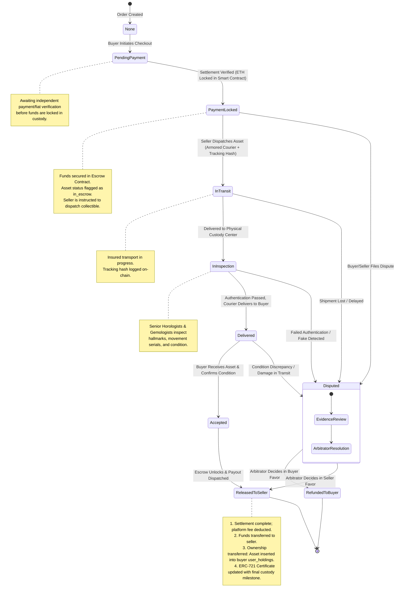
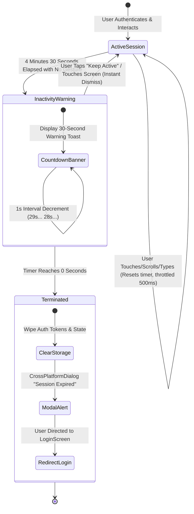
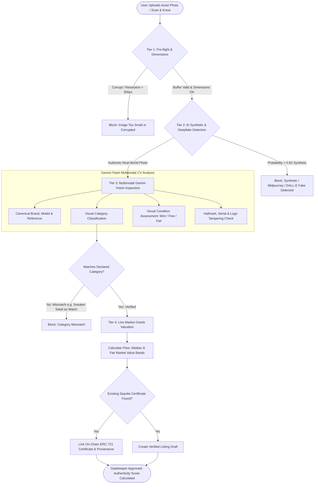
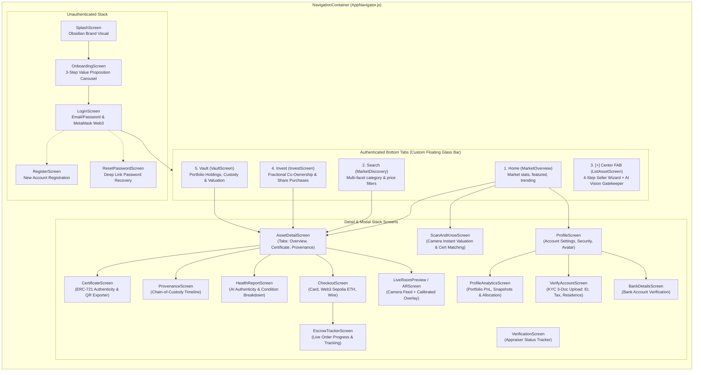
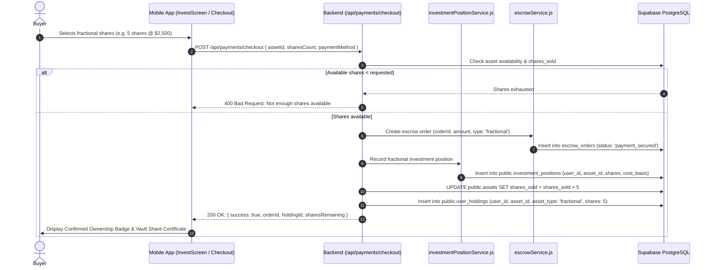
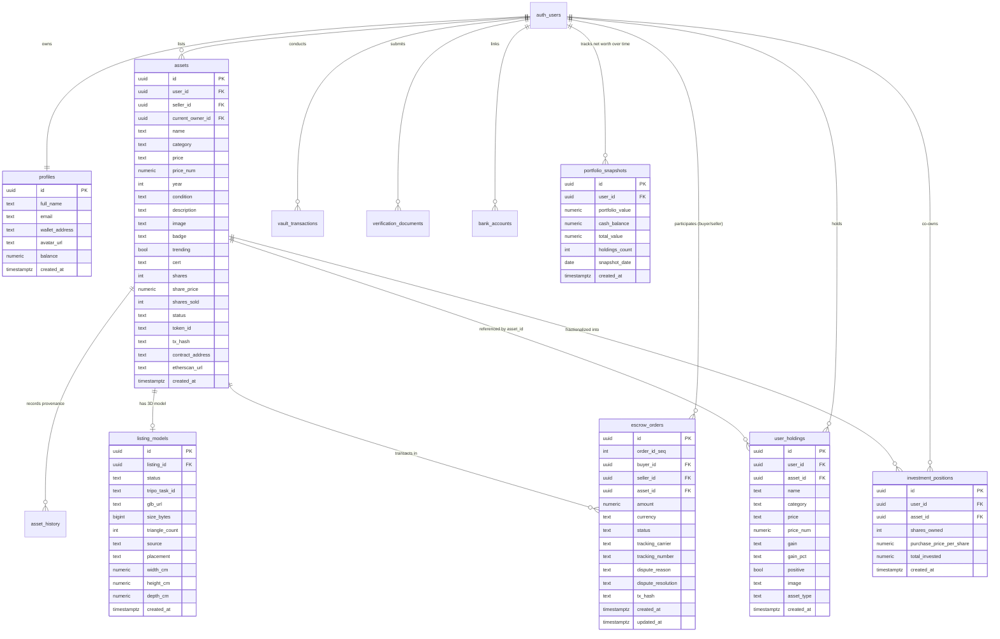

# SmartAssets — Master System Diagrams & Visual Architecture Guide

> **Scope:** This document is the visual blueprint for SmartAssets, containing production-accurate Mermaid diagrams for every subsystem: overall multi-tier architecture, escrow state machine, AI Vision Gatekeeper pipeline, mobile navigation topology, Web3 SIWE authentication, fractional co-ownership investment lifecycle, 3D glTF optimization, financial session inactivity lifecycle, portfolio snapshot time-series engine, and the Supabase PostgreSQL entity relationship diagram (ERD).

---

## 1. End-to-End System Architecture

The following diagram illustrates the interaction between the **Client Tier** (React Native Expo App), the **Backend API & Gateway Tier** (Express.js, Security, Rate Limiter, Inactivity Heartbeat, WebSockets), the **Intelligence & Services Tier** (Gemini AI Vision, Compliance/KYC, Market Oracle, Escrow Manager, Portfolio Snapshot Service), the **Storage & Database Tier** (Supabase PostgreSQL with RLS, Cloudinary, Local/Signed KYC Storage), and the **Decentralized Settlement Tier** (Ethereum Sepolia, Hardhat, ERC-721 Certificates, Escrow Smart Contract).

```mermaid
flowchart TB
    %% Client Tier
    subgraph CLIENT_TIER ["Client Tier (Mobile, Web & Sensor Systems)"]
        direction TB
        RN["React Native Expo SDK 54 App<br/>(iOS / Android / Web)"]
        WATCHER["InactivityWatcher & CrossPlatformDialog<br/>(Passive PanResponder Gesture Capture)"]
        CAM["Live Room Preview & AR<br/>(Expo Camera & Device Motion)"]
        WALLET["Web3 Wallets<br/>(MetaMask / Injected EIP-1193)"]
        RN --- WATCHER
        RN --- CAM
    end

    %% Security & API Gateway
    subgraph API_GATEWAY ["API Gateway & Security Layer (Express.js :5000)"]
        direction TB
        HELMET["Helmet & Strict Security Headers"]
        RATELIMIT["Rate Limiter (Auth & Uploads)"]
        SQL_GUARD["SQL Injection Sanitizer"]
        AUTH_MW["Auth & KYC Middleware<br/>(requireAuth, requireVerified, requireApprovedBank)"]
    end

    %% Core Services Tier
    subgraph SERVICES_TIER ["Backend Domain Services Tier"]
        direction TB
        AI_GATEKEEPER["AI Vision Gatekeeper Service<br/>(Gemini Flash Multimodal CV)"]
        COMPLIANCE["Compliance & KYC Engine<br/>(ID, Tax, Bank Acc, Proof of Residence)"]
        ORACLE["Live Market Oracle<br/>(ZAR Valuation Bands, Historical Volatility)"]
        ESCROW_SRV["Escrow Service & State Manager<br/>(Durable Lifecycle & Dispute Engine)"]
        PORTFOLIO_SRV["Portfolio Snapshot Service<br/>(Dated Valuation History & Time-Series)"]
        INVESTMENT_SRV["Investment Position Service<br/>(Fractional Ownership, Co-ownership Units)"]
        MODEL_SRV["3D Pipeline & glTF Transform<br/>(Tripo AI + Meshoptimizer Decimation)"]
        WEB3_SRV["Web3 Integration Service<br/>(Ethers.js v6, Nonce, SIWE EIP-4361)"]
        STRIPE_SRV["Stripe Checkout Service<br/>(Card & Bank Transfers)"]
        PRESENCE_SRV["WebSocket Presence & Inactivity Heartbeat"]
    end

    %% Data & Storage Tier
    subgraph DATA_TIER ["Data & Persistence Tier"]
        direction TB
        SUPA_DB[("Supabase PostgreSQL DB<br/>Row-Level Security (RLS)")]
        SUPA_AUTH["Supabase Auth Service<br/>(JWT, Sessions, Passwords)"]
        SECURE_STORE[("Gated KYC Storage<br/>(Private Signed URLs)")]
        PUBLIC_CDN[("Cloudinary & Public Assets CDN<br/>(Avatars, Listing Photos, glTF Models)")]
    end

    %% Blockchain Tier
    subgraph BLOCKCHAIN_TIER ["Decentralized Settlement Tier (Ethereum Sepolia)"]
        direction TB
        SMART_CERT["SmartAssetCertificate.sol<br/>(ERC-721 + On-Chain Provenance Milestones)"]
        SMART_ESCROW["SmartAssetEscrow.sol<br/>(ReentrancyGuard, 9-State Escrow Contract)"]
    end

    %% Flow Connections
    RN <-->|REST API JSON & File Uploads| HELMET
    RN <-->|Heartbeat & Presence Sockets| PRESENCE_SRV
    RN <-->|Web3 Signing| WALLET
    WALLET <-->|EIP-4361 Signatures| WEB3_SRV

    HELMET --> RATELIMIT --> SQL_GUARD --> AUTH_MW

    AUTH_MW --> AI_GATEKEEPER
    AUTH_MW --> COMPLIANCE
    AUTH_MW --> ORACLE
    AUTH_MW --> ESCROW_SRV
    AUTH_MW --> PORTFOLIO_SRV
    AUTH_MW --> INVESTMENT_SRV
    AUTH_MW --> MODEL_SRV
    AUTH_MW --> STRIPE_SRV

    AI_GATEKEEPER <-->|Vision Analysis API| GOOGLE_GEMINI["Google Gemini Vision API"]
    MODEL_SRV <-->|Mesh Tasks| TRIPO_API["Tripo 3D AI Engine"]

    COMPLIANCE <--> SECURE_STORE
    COMPLIANCE <--> SUPA_DB
    ESCROW_SRV <--> SUPA_DB
    ESCROW_SRV <--> SMART_ESCROW
    PORTFOLIO_SRV <--> SUPA_DB
    INVESTMENT_SRV <--> SUPA_DB
    ORACLE <--> SUPA_DB
    AUTH_MW <--> SUPA_AUTH

    WEB3_SRV <--> SMART_CERT
    WEB3_SRV <--> SMART_ESCROW
    MODEL_SRV --> PUBLIC_CDN
```



---

## 2. Escrow Sequential Lifecycle & Dual-Ledger State Machine

SmartAssets enforces an airtight sequential progression. An order initializes as `pending_payment` during transaction settlement, advances to `payment_secured` upon verified funds capture, flows through physical authentication, and transitions asset ownership directly to the buyer's vault holdings upon final release:



---

## 3. Financial Inactivity Watcher & Session Security Lifecycle

High-value financial assets require defense against unattended session hijacking. The `InactivityWatcher` wraps the application in a transparent `PanResponder` that intercepts all gestures without touch-blocking, resetting a 5-minute inactivity counter and presenting a 30-second warning countdown before automated logout:



---

## 4. Portfolio Snapshot & Time-Series Valuation Engine

To provide reliable portfolio analytics without recalculating historical values on the fly, the `portfolioSnapshotService` persists daily snapshot records in `public.portfolio_snapshots`:

```mermaid
flowchart TD
    EVENT[Trigger: Vault Deposit, Holding Purchase, Escrow Release, or Daily Cron] --> CALC[Calculate User Portfolio Snapshot]
    
    subgraph CALCULATION ["Valuation Matrix"]
        CALC --> SUM_HOLDINGS[Sum User Whole & Fractional Holdings Value]
        CALC --> CASH_BAL[Fetch Available Cash Balance]
        CALC --> ESCROW_BAL[Fetch Pending Escrow Inflow/Outflow]
        SUM_HOLDINGS & CASH_BAL & ESCROW_BAL --> TOTAL[Combined Net Worth]
    end

    TOTAL --> UPSERT[Upsert public.portfolio_snapshots<br/>UNIQUE constraint: (user_id, snapshot_date)]
    UPSERT --> SYNC_CACHE[Sync In-Memory Runtime Cache snapshotsMap]

    subgraph CLIENT_QUERY ["Client Analytics Request (/api/user/analytics)"]
        REQ[ProfileAnalyticsScreen Requests Period: 24h, 7d, 30d, 1y] --> QUERY_DB[Query Ordered Snapshots ASC]
        QUERY_DB --> DERIVE[Derive Metrics: MTD Change, ROI Yield %, Performance Trendline]
        DERIVE --> RENDER[Render Smooth Interactive Chart in Mobile App]
    end

    SYNC_CACHE -.-> QUERY_DB
```

---

## 5. AI Vision Multi-Tier Gatekeeper Pipeline

The AI Vision Gatekeeper (`aiVisionGatekeeper.js`) screens collectible listings before they can be submitted or verified on the marketplace. It evaluates image clarity, checks for synthetic AI generation, detects category mismatches, and fetches live appraisal valuation bands.



---

## 6. Mobile Navigation Topology & Screen Hierarchy

The mobile application (`Public/App`) is built on **React Navigation v7**, using a unified root stack with nested bottom tabs and contextual modal detail screens:



---

## 7. Web3 Signature Authentication & Session Flow (SIWE / EIP-4361)

Sign-In With Ethereum allows users to securely log into SmartAssets with MetaMask or any EVM wallet without requiring a password:

```mermaid
sequenceDiagram
    autonumber
    actor User as User (MetaMask / Mobile)
    participant App as React Native App
    participant API as Express API (/api/auth)
    participant Web3 as web3Service.js
    participant Supa as Supabase Auth & Profiles
    participant Eth as Ethereum RPC / Ethers

    User->>App: Clicks "Connect MetaMask"
    App->>API: GET /api/auth/nonce?address=0xUser...
    API->>Web3: Generate cryptographically secure nonce
    Web3-->>API: Nonce + Expiry (5 minutes)
    API-->>App: { nonce: "sa_nonce_7f2b9a..." }

    App->>User: Prompts EIP-4361 standard message to sign
    User->>App: Approves & signs with private key
    App->>API: POST /api/auth/wallet-login { address, signature, message }

    API->>Web3: verifyMessage(message, signature)
    Web3->>Eth: Recovers signer address from ECDSA signature
    Web3-->>API: Recovered address matches claimed address

    API->>Supa: Query public.profiles where wallet_address = 0xUser...
    alt Profile Exists
        Supa-->>API: User profile & Supabase user ID
    else Profile Does Not Exist
        API->>Supa: Create synthetic user & link wallet_address in public.profiles
        Supa-->>API: New user record created
    end

    API->>Supa: Issue authenticated session JWT
    API-->>App: { success: true, token, user, profile }
    App->>App: Store JWT in secure storage; transition to Authenticated MainTabs
```

---

## 8. Fractional Co-Ownership & Investment Order Execution

When a user purchases shares in a high-value collectible, the transaction updates the marketplace asset and creates an isolated investment position in the user's vault:



---

## 9. 3D Mesh Generation & Decimation Pipeline

SmartAssets generates interactive 3D assets from single images using Tripo AI and automatically optimizes the polygonal meshes for mobile 60 FPS rendering using `@gltf-transform/core` and `meshoptimizer`:

```mermaid
flowchart LR
    IMG[Listing Image / Photo] --> TRIPO_API[Tripo AI Task Submission<br/>POST /v2/openapi/task]
    TRIPO_API --> POLL[Poll Task Status<br/>status: 'running' -> 'success']
    POLL --> RAW_GLB[Download Raw glTF/GLB<br/>500k+ Triangles, 45MB+]

    subgraph OPTIMIZER ["Backend modelOptimizer.js"]
        RAW_GLB --> PARSE[Parse via @gltf-transform/core]
        PARSE --> DECIMATE[Meshoptimizer Simplification<br/>Target: 35,000 Triangles]
        DECIMATE --> RESIZE_TEX[Downscale Textures to 2048x2048 KTX2/WebP]
        RESIZE_TEX --> QUANTIZE[Quantize Vertex Attributes]
    end

    QUANTIZE --> OPT_GLB[Optimized GLB<br/>~2.5MB, 60 FPS Mobile Ready]
    OPT_GLB --> UPLOAD_CDN[Upload to CDN / Static Storage]
    UPLOAD_CDN --> DB_RECORD[Write listing_models Table in Supabase]
    DB_RECORD --> APP_RENDER[Render in ARScreen & LiveRoomPreview]
```



---

## 10. Supabase PostgreSQL Entity Relationship Diagram (ERD)

The durable source of truth is structured into normalized tables with foreign keys and Row-Level Security:


